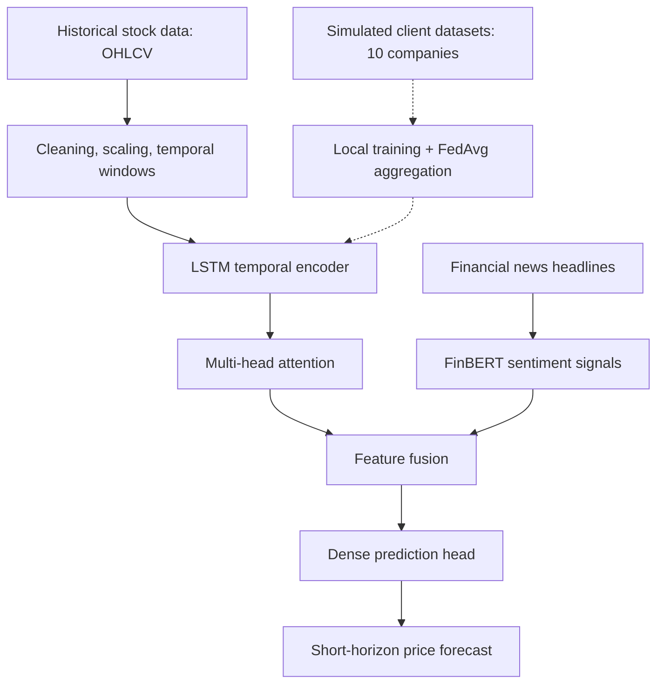
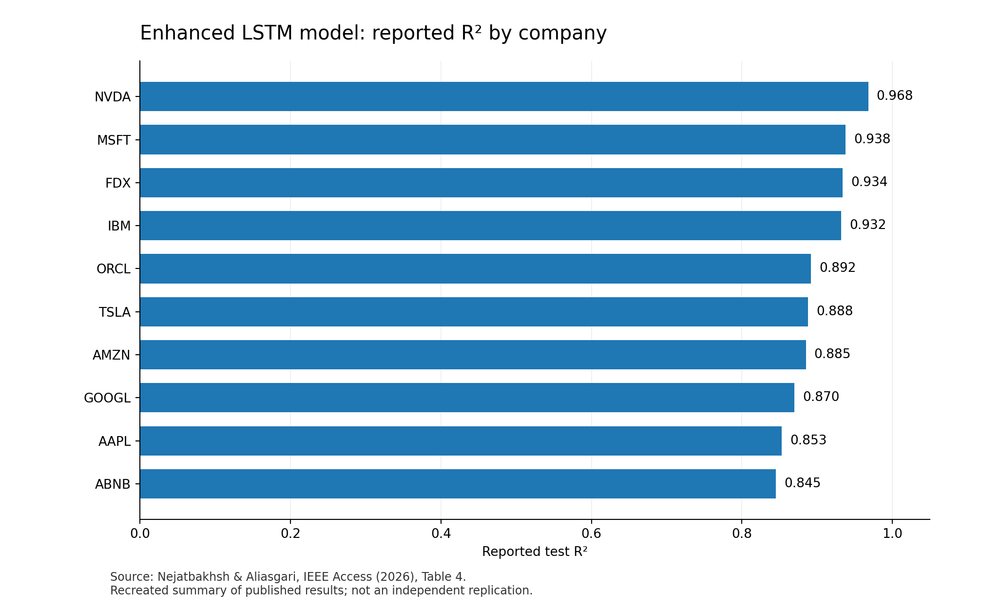

# Hybrid Stock Market Forecasting with LSTM, Transformer Attention, FinBERT, and Federated Learning

**Research portfolio · Deep Learning · Time-Series Forecasting · NLP · Federated Learning**

> **Publication status:** Published, peer-reviewed research in **IEEE Access**, Volume 14 (2026).  
> **Paper:** *Enhancing Stock Market Prediction With Hybrid Deep Learning: Integrating LSTM, Transformer Attention, Federated Learning, and Sentiment Analysis*  
> **Authors:** **Yousef Nejatbakhsh** and **Malihe Aliasgari**  
> **Published online:** December 30, 2025  
> **DOI / paper:** https://doi.org/10.1109/ACCESS.2025.3649668

## Overview

This research investigates **hybrid deep learning for short-horizon stock-price forecasting**. The approach combines numerical market information, attention-based temporal modeling, sentiment features derived from financial news, and **simulated federated learning**. The objective is to study how these components can be integrated and evaluated under chronological train/test splits.

The project is presented as a **research and engineering portfolio**. It is not a live trading system and does not provide financial advice or evidence of profitable investment performance.

## Technical Architecture

This diagram is a high-level description of the published architecture, not an executable model specification. In the study, each company's stock history represented a client in a **federated-learning simulation**; real financial institutions were not connected.

## Methods

- **Numerical inputs:** OHLCV data, adjusted close, and selected moving-average indicators from historical stock series.
- **Temporal modeling:** LSTM networks capture patterns across sliding windows of previous trading days.
- **Attention:** Multi-head attention emphasizes informative time steps in the sequential representation.
- **News sentiment:** FinBERT-tone transforms news headlines into sentiment features aligned to trading dates. The available sentiment sample was limited to approximately 30 days.
- **Training strategy:** Chronological splits were used; the hybrid experiments describe a 70% / 15% / 15% train/validation/test allocation.
- **Federated-learning proof of concept:** Local models for ten public-company stock histories were aggregated using **Federated Averaging (FedAvg)**. This is a simulation, not a deployed multi-institution system or a formal privacy guarantee.
- **Baseline models:** ARIMA, SARIMAX, Prophet, Random Forest, Support Vector Regression, exponential-smoothing approaches, and baseline LSTM models.

## Published Evaluation

The study analyzes stock histories from **Tesla, Apple, Airbnb, Amazon, FedEx, IBM, Microsoft, Nvidia, Oracle, and Google**, with particular attention to short-term forecasts. It reports prediction-error and goodness-of-fit measures, including **MAE, MSE, and R²**, as well as a separately described trend-related measure for the baseline LSTM.

### Company-level R² results

*Figure 1. R² values reported for the enhanced LSTM model in Table 4 of the published article, recreated for this portfolio. These values are from the paper and have not been independently re-run for this repository.*

The paper's **Table 4** reports enhanced-model R² values between **0.845 and 0.968** across the ten companies. The arithmetic mean of the displayed Table 4 values is approximately **0.901**. These are experimental goodness-of-fit measurements and should **not** be interpreted as forecast profitability, consistent live-trading accuracy, or evidence of secure real-world federated deployment.

**Metric distinction:** The paper separately reports a baseline LSTM trend-related result; it is **not** the R² score of the enhanced hybrid architecture. The published trend-related metric should not be treated as an independently validated trading-direction accuracy measure without examining the original evaluation protocol.

## Industry-Relevant Skills

| Area | Demonstrated research methods |
|---|---|
| Deep learning | LSTM sequence models, multi-head attention, feature fusion |
| Natural language processing | Financial headline sentiment analysis using FinBERT |
| Distributed ML | Simulated federated training and FedAvg aggregation |
| Time-series analytics | Sliding windows, chronological evaluation, financial indicators |
| Model evaluation | Baseline comparisons, MAE, MSE, R², ablation analysis |
| Research engineering | Modular pipeline design and comparative experimentation |

## Important Limitations

- The experiments use **historical market data**, not a live market deployment.
- News sentiment coverage is limited to a short window by the source API.
- Federated training is **simulated**; the experiment does not demonstrate differential privacy or immunity from information leakage via model updates.
- Results are specific to the reported stocks, data windows, and experiment settings; volatility and regime changes can affect generalization.
- The numerical results above are **reported published results**, not newly computed or independently replicated results in this repository.

## Public Repository Scope

**Included:** Publication reference, technical overview, architecture diagram, and a recreated figure summarizing published results.  
**Not included:** Complete training code, internal experiments, model weights, API credentials, downloaded news articles, or the full data-processing pipeline.

Future portfolio additions may include **standalone demonstrations on synthetic time series**; any such demonstrations will be clearly separated from the published study and its results.

## Publication and Contact

- **Published article:** [IEEE Access — DOI: 10.1109/ACCESS.2025.3649668](https://doi.org/10.1109/ACCESS.2025.3649668)
- **Researcher:** Malihe Aliasgari, Ph.D.
- **Research website:** https://malihealiasgari20.github.io/
- **GitHub:** https://github.com/malihealiasgari20

This portfolio summary acknowledges both authors and does not imply that the underlying research implementation is publicly released.
